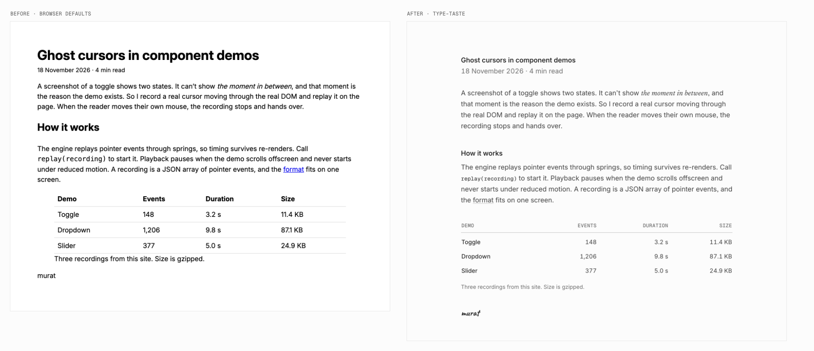

# skills

Agent skills for building interfaces with taste, by [Murat Alpay](https://muratalpay.me). Site: [skills.muratalpay.me](https://skills.muratalpay.me).

```sh
npx skills add imuratalpay/skills
```

One command installs every skill in `skills/`. Run it again to pick up new ones. It works with Claude Code, Cursor, Codex and the other agents the [skills CLI](https://github.com/vercel-labs/skills) supports. Add `-g` to install for every project.

| Skill | What it does | When it runs |
|---|---|---|
| [`/ui-diff`](skills/ui-diff/SKILL.md) | Before, after and diff screenshots of a UI pull request, in one sticky PR comment. | On its own when a PR or branch changes UI, or when you type `/ui-diff` |
| [`/type-taste`](skills/type-taste/SKILL.md) | Measured type values: Inter, a serif italic for emphasis, and grey before weight before size. | On its own for any typography work, or when you type `/type-taste` |
| [`/ghost-record`](skills/ghost-record/SKILL.md) | Records a ghost-cursor demo of a React component from one sentence. | Only when you type `/ghost-record` (`$ghost-record` in Codex) |

## /ui-diff

Screenshots every route a pull request touches at base and head, diffs them and posts one sticky PR comment with `before | after | diff` images and a short UX summary. The images live on an orphan branch of the same repository, so only people who can read the repo can see them. Needs git and Node.js 20.10+; the GitHub CLI only to post. The standalone CLI and docs: [imuratalpay/ui-diff](https://github.com/imuratalpay/ui-diff).

```
/ui-diff run on PR #123 and update the sticky comment
Show me what my branch changes visually before I open the PR.
```

## /type-taste

Typography values measured on 18 sites I like. Quiet Inter at reading size, a real serif italic for emphasis, mono for code and labels, hierarchy from grey first, weight second, size last. Ships `tokens.css`, a Tailwind and `next/font` setup, and a browser-console audit.

```
/type-taste fix the typography on this page
/type-taste audit the blog post template
```



## /ghost-record

Turns one sentence into a recorded [ghost-cursor](https://github.com/imuratalpay/ghost-cursor) demo of a React component. It records with human-like input, replays the take to check it, saves `<component>.take.json` and prints the snippet to paste. It never runs on its own.

```
/ghost-record like button: hover, then click it
```

## Adding a skill

1. Create `skills/<name>/SKILL.md`. The folder name and `name:` must match: lowercase letters, numbers and hyphens.
2. Write the frontmatter:
   - `description` says what the skill does and when to use it, with a `Use when ...` sentence that names the tasks and words that should trigger it. Agents pick skills from this line alone.
   - For a skill that should only run when someone types `/<name>`, add `disable-model-invocation: true` (Claude Code, Cursor) and `skills/<name>/agents/openai.yaml` with `policy: { allow_implicit_invocation: false }` (Codex).
3. Put scripts in `scripts/`, longer docs in `references/`, and refer to them by relative path from `SKILL.md`. No secrets, `node_modules` or build output.
4. Add the skill to the table above and to `AGENTS.md`, and add it to the site in `site/lib/skills.ts` and `site/lib/nav.ts`.
5. Check discovery: `npx skills add . --list` from the repo root lists every skill.

## Fonts

Bundled fonts are free under the SIL Open Font License: Inter, Newsreader, Geist Mono, Caveat.
